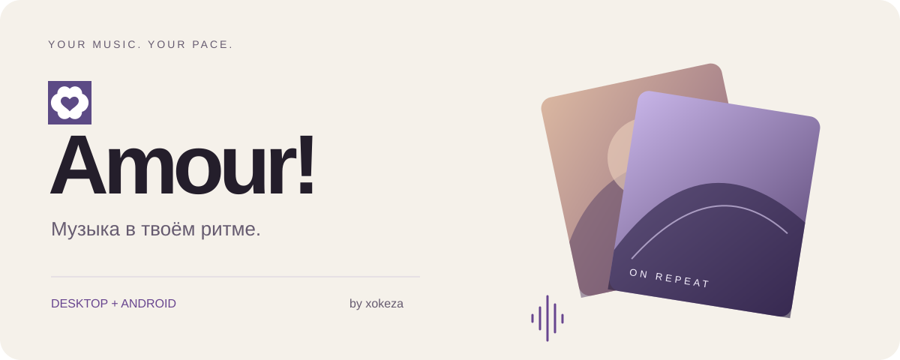

<div align="center">

<picture><source media="(prefers-color-scheme: dark)" srcset="assets/hero-dark.svg"></picture>

<br>

<a href="https://github.com/xokeza/Amour/releases/latest/download/Amour-0.2.18.AppImage"><picture><source media="(prefers-color-scheme: dark)" srcset="assets/linux-dark.svg"></picture></a>&nbsp;<a href="https://github.com/xokeza/Amour/releases/latest/download/Amour-Setup-0.2.18.exe"><picture><source media="(prefers-color-scheme: dark)" srcset="assets/windows-dark.svg"></picture></a>&nbsp;<a href="#разработка"><picture><source media="(prefers-color-scheme: dark)" srcset="assets/source-dark.svg"></picture></a>

<br><br>

**Музыкальный плеер от [xokeza](https://github.com/xokeza).**<br>
Любимые треки, своя библиотека и «Моя волна» — в одном приложении.

[Релизы](https://github.com/xokeza/Amour/releases) · [Сообщить о проблеме](https://github.com/xokeza/Amour/issues) · [Telegram](https://t.me/xokeza) · [Сайт](https://xokeza.su)

</div>

## Всё для прослушивания

- **Моя волна.** Персональный подбор музыки, непрерывная очередь и анимированные переходы между обложками.
- **Твоя библиотека.** Лайки, плейлисты, история и локальные аудиофайлы.
- **Импорт по ссылке.** YouTube, Spotify, Apple Music, Deezer и SoundCloud.
- **Тексты песен.** Синхронизация с воспроизведением, когда тайминги доступны.
- **Настраиваемый интерфейс.** Темы, визуализация, отдельный overlay-плеер на ПК.
- **Android.** Нижняя навигация, мини-плеер и полноэкранное управление. [Инструкция](desktop/docs/ANDROID.md).

## Установка

| Платформа | Файл | Как запустить |
| --- | --- | --- |
| Linux x64 | `Amour-0.2.18.AppImage` | Разреши выполнение файла и открой его |
| Windows x64 | `Amour-Setup-0.2.18.exe` | Запусти установщик |

Все файлы находятся в [GitHub Releases](https://github.com/xokeza/Amour/releases/latest). Контрольные суммы — в `SHA256SUMS.txt` рядом со сборками. Windows-установщик не подписан сертификатом издателя.

```sh
chmod +x Amour-0.2.18.AppImage
./Amour-0.2.18.AppImage
```

Для онлайн-каталога и потокового воспроизведения нужен доступ к YouTube. Доступность внешних сервисов зависит от региона и сети.

## Разработка

**Node.js 22.13+ · pnpm 10+**

```sh
git clone git@github.com:xokeza/Amour.git
cd Amour/desktop
pnpm install --frozen-lockfile
pnpm dev
```

```sh
pnpm lint
pnpm exec tsc -b
pnpm test
pnpm electron:build:linux
# На Windows:
pnpm electron:build:win
```

| Каталог | Содержимое |
| --- | --- |
| `desktop/src` | Интерфейс: React, TypeScript, Zustand, Tailwind CSS |
| `desktop/electron` | Окна, файловая система, аудио и интеграции с ОС |
| `desktop/android` | Android-оболочка на Capacitor |
| `api` | API аккаунтов и библиотеки: Fastify + SQLite |
| `assets` | SVG-оформление README для светлой и тёмной темы |

API приложения: `https://xokeza.su/amour/api/`. Развёртывание и контракты описаны в [api/README.md](api/README.md). Для существующих аккаунтов сохранена совместимость с предыдущим сервисом; доступность старых данных зависит от него.

## Документация

[Android](desktop/docs/ANDROID.md) · [Приватность](desktop/docs/PRIVACY.md) · [Хранение данных](desktop/docs/STORAGE.md) · [FAQ](desktop/docs/FAQ.md) · [Участие в разработке](desktop/CONTRIBUTING.md)

## Автор и лицензия

**Amour! — проект [xokeza](https://github.com/xokeza).**

Условия использования исходников и распространяемых компонентов указаны в [LICENSE](LICENSE). Существующие уведомления об авторских правах сохранены; репозиторий не распространяется под MIT или другой неограниченной open-source лицензией.
